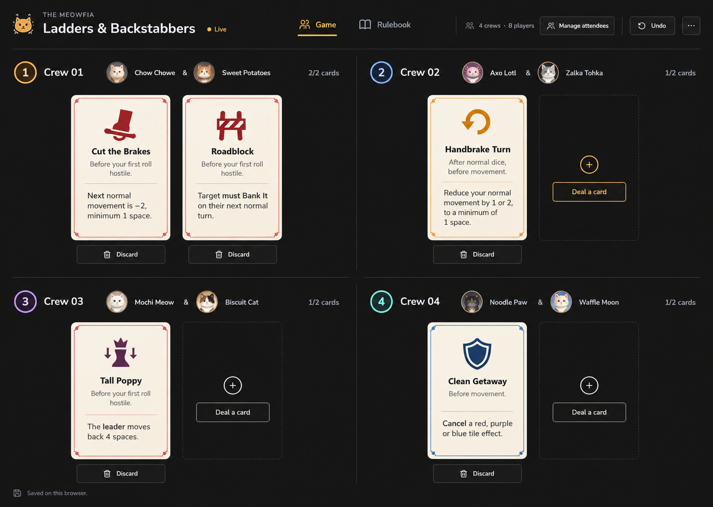
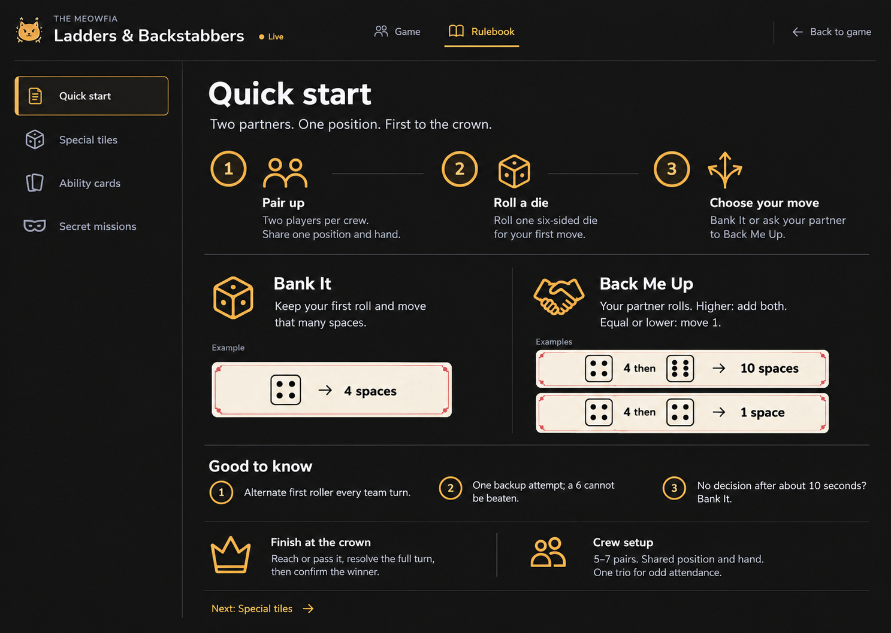

# Ladders & Backstabbers: design and implementation handoff

> Superseded on 25 October 2026 by [Cartel Gil Rush](cartel-gil-rush-implementation.md). This file is historical design context. Its crew/card mechanics, route, persistence, undo requirements and acceptance checklist no longer apply. Existing cream card styling is retained for special-tile references; Game / Rulebook layout and accessibility guidance remain relevant.

Approved: 19 October 2026. Target: existing Fat Cat Cartel React/TypeScript website.

## 1. Approved visual direction

Combine **live game design 1** with **rulebook design 2**. These are selections from two different concept sets. The two files below are the authoritative visual references; do not substitute another generated option.

### Game: open tabletop with cream ability cards



### Rulebook: chapter rail and illustrated quick start



The images establish composition, hierarchy, palette and character. Current game definitions and existing state logic establish behaviour. Where generated image copy conflicts with the rules below, the rules below win.

This document specifies a future implementation. Creating this handoff does not implement the redesign.

## 2. Outcome and scope

Make the event feel like a considered tabletop product: crews and tactile playing cards are the main experience, with a separate, concise rulebook when needed.

- Keep `/ladders-and-backstabbers` and the existing app shell/sidebar.
- Add top-level **Game / Rulebook** tabs within that page. These are views, not new routes.
- Default to Game, including its attendee setup state before the event starts.
- Keep the entire page and host controls behind the existing Boss/Underpaw access check. This redesign does not make the page public.
- Preserve local browser persistence. Add no Firebase reads, writes, listeners, Functions, player lookups or external integrations.
- Keep card effects, dice, movement, missions and prize bookkeeping manual.
- Keep attendee entry, pair preview/swaps, confirmation, deal, discard, undo and reset working.
- Do not add scores, a digital board, turns, countdowns, event logs, card-effect automation or registration.

## 3. Existing implementation to preserve

| File | Responsibility |
| --- | --- |
| `src/features/ladders-and-backstabbers/index.tsx` | Thin route export |
| `components/LaddersAndBackstabbersPage.tsx` | Current auth gate and rulebook/page shell |
| `components/EventHostPanel.tsx` | Attendee dialogs, pairing controls and crew/hand display |
| `components/RulebookDialog.tsx` | Existing scrollable reference dialog |
| `constants.ts` | Tile, ability and mission definitions |
| `types.ts` | Attendees, crews, event phases and actions |
| `hooks/useLocalEvent.ts` | Load, save, error reporting and stale-tab protection |
| `utils/localEvent.ts` | Pure event operations and saved-state validation |
| `tests/ladders-local-event.test.ts` | Behaviour regression tests |

Paths in this table are relative to `src/features/ladders-and-backstabbers/` unless already prefixed with `src/` or `tests/`.

Preserve the existing localStorage key `fcc_ladders_and_backstabbers_event_v1`, schema version, attendee IDs, crew IDs, hands and one-step undo. Do not migrate or reset saved events for a visual change.

Mount **one** `useLocalEvent()` owner above both views. Switching tabs or rulebook chapters must not create another event instance, reload event data, deal cards or erase dialog/form state unexpectedly. Keep view-selection state separate from persisted event data.

Read `docs/frontend-patterns.md`, `docs/project-reference.md` and `docs/admin-auth-implementation.md` before implementation. Follow repository `AGENTS.md` conventions; use `@/` for cross-feature imports and explicit local imports.

## 4. Shared page header

Desktop hierarchy:

1. Existing small Fat Cat Cartel asset, `THE MEOWFIA` eyebrow and `Ladders & Backstabbers` title.
2. Phase text with a small status dot: Setup, Pairing preview or Live, derived from actual event state.
3. Game / Rulebook tabs, active tab indicated by gold text and a short gold underline.
4. Contextual host tools on Game; a quiet Back to game action on Rulebook.

Use a thin bottom divider. Keep the header compact; no hero section, marketing copy or large banner artwork. Preserve the real global sidebar and fit this header inside its content area; the mockup is a feature canvas, not a replacement app shell.

On narrow layouts, stack title and tools above a full-width tab row. Wrap rather than truncate the game title. A sticky feature header is not required.

## 5. Game view

### Layout

- Use two crew columns when the feature content area can comfortably hold two hands. Approximately 1000px of available content width is a useful starting point; account for the global sidebar.
- Use one crew column when narrower. Allow normal page scrolling for 5 to 7 crews; do not shrink cards and text to force every crew into one viewport.
- Each crew is an open section on the base background. Separate sections using spacing and thin rules, not a generic gray card container.
- Crew header: numbered colour marker, `Crew 01`, member names and `1/2 cards` or `2/2 cards` aligned consistently.
- Use stable per-crew accent colours. Always retain visible numbers/names; colour does not carry identity alone.
- Render a trio's third member cleanly without changing its resources or hand limit.

### Playing cards

The ability itself is the card-shaped object. It should read as a small physical game card rather than a block of dashboard text.

- Warm ivory face, dark ink, modest rounded corners and a fine coloured inner border.
- Centred Lucide icon, short card title, timing, fine divider and concise effect.
- Approximate desktop starting dimensions: 190 to 220px wide, roughly 290 to 330px tall. These are layout targets, not fixed clipping boxes.
- Keep body copy at 14 to 16px. Permit height growth or open a full-detail dialog if needed; never clip rules or reduce them to tiny print.
- Restrained red accents for attacks, amber for movement and blue/sage for tile defence. Include a category label so colour is supplementary.
- Place a clear Discard action beneath each held card, visually quieter than Deal.
- Each empty slot uses the outlined card-sized Deal affordance shown in the selected reference. Its label is **Deal a card**. This is an intentional hand slot, not a loading skeleton.
- A zero-card hand shows two slots, both dealing one card through the same crew action. A one-card hand shows one slot. Both slots still obey the two-card limit under repeated clicks.
- A full hand displays `2/2 cards`; avoid an additional large disabled Hand full button.

Use actual source assets for any decorative imagery. Do not cut up the mockup and ship it as the interface. Card icons must be Lucide components. The simple card frame may use Tailwind borders; elaborate illustration or ornamental assets require real reusable assets.

### Toolbar and actions

| State | Primary task | Supporting controls |
| --- | --- | --- |
| Setup, no attendees | Add attendees | Rulebook, reset in overflow |
| Setup, at least two attendees | Randomise pairs | Manage attendees, undo if available |
| Pairing preview | Confirm crews & deal | Reshuffle, click two members to swap, manage attendees, undo |
| Live | Deal/discard within crew hands | Undo, attendee count, reset in overflow |

- Keep count copy factual, e.g. `6 crews · 12 players`.
- Preserve attendee editing before confirmation. Trim whitespace and reject duplicate names ignoring case.
- Attendee changes invalidate unconfirmed pairings, as they do now.
- Confirmation locks pairings and deals one random card per crew atomically. Clearly state this before the host clicks.
- Manage attendees remains disabled or read-only in Live; do not accidentally re-enable mutations because the mockup shows an enabled-looking control.
- Move Reset event into the ellipsis menu. Selecting it still opens the existing confirmation dialog.
- Preserve Undo last action, including after refresh and reset. Do not turn it into multi-step history or redo.
- Discard is immediate and undoable; no confirmation on every discard. Show the card effect before the action.
- A deal is random from enabled abilities. Allow duplicates across crews, exclude duplicates inside a hand, maximum two cards.
- Use `Saved on this browser` as quiet copy. Never imply cloud sync, shared host state or guaranteed private storage.
- Keep storage failure and stale-tab errors visible near the relevant action. Do not claim a save succeeded when it failed.

### Avatars and brand artwork

The mockup's cat portraits and crest are visual suggestions, not a requirement for a new identity system. Prefer existing local Fat Cat assets for branding. For attendee portraits, use a consistent local decorative cat asset or initials; manual attendee names do not have profile/avatar data. Add no Firebase member fetches, remote avatar generation or avatar selection workflow.

## 6. Rulebook view

### Navigation and layout

- Preserve the same page header; Rulebook is the selected top-level tab.
- Desktop: a narrow contents rail on the left, approximately 200 to 240px, with one thin vertical separator. Content fills the remaining area.
- Chapters: **Quick start**, **Special tiles**, **Ability cards**, **Secret missions**.
- Only one chapter is visible at a time. The rail is persistent chapter navigation, not a list of expandable cards.
- Mark the selected chapter with a gold left edge, restrained tint and text emphasis. Include its Lucide icon.
- Mobile: convert the rail into a compact chapter Select or horizontally scrollable chapter tabs. Keep chapters keyboard accessible and content below them.
- Back to game returns to the existing event view without resetting it. Retain the selected rulebook chapter for the current page session.

### Quick start: match the selected second rulebook image

Use a compact title `Quick start` and subheading `Two partners. One position. First to the crown.`

1. A three-step horizontal introduction: Pair up / Roll `/random 6` / Choose your move. Stack this introduction on phones.
2. Side-by-side Bank It and Back Me Up explanations, with large but restrained Lucide icons. These are open sections, not boxed dashboard cards.
3. Cream example strips echo the ability-card paper/frame treatment:
   - Bank It: first 4 means move 4.
   - Backup: first 4, backup 6 means move 10.
   - Backup: first 4, backup 4 or 2 means move 1.
4. A short Good to know row: alternate first roller; one backup attempt and a 6 cannot be beaten; about 10 seconds to choose, default Bank It.
5. A concise finish note and crew setup note separated by a fine rule.
6. Next: Special tiles changes the selected chapter; it is not a dead decorative link.

Show dice examples using real Lucide dice icons and accessible text. Decorative connectors must not be necessary to understand the calculation. Do not copy incorrect die-face drawings from generated images.

### Special tiles

Use an airy two-column illustrated legend on desktop and a single column on phones. No nested cards and no new game controls. Label both colour/theme and effect.

| Tile | Correct displayed rule |
| --- | --- |
| Orange / alpha: Duel Chow | Both partners duel Chow. Each earns 500,000 gil for a win, 100,000 gil for a loss. Stay on the tile. |
| Purple / mushroom: Wrong Getaway Car | Roll `/random 6` and move backwards by the result. |
| Blue / shark: Police Raid | Move backwards 3 spaces immediately. No skipped turn. |
| Green / ladder: Connections Upstairs | Move to the host-set ladder endpoint. |
| Red / fall arrow: Ratted Out | Move to the host-set fall endpoint. |
| Brown / moogle: Axo's Trivia | Axo gives a trivia challenge. Success earns 500,000 gil each. Stay on the tile. No loss payout was specified. |
| Crown: The Big Boss | Reach or pass it and finish resolving the turn before the host confirms the winner. |

Keep one concise note: resolve only the first special tile reached by normal movement. Extra tile movement never chains, and ability movement does not trigger tiles. Positions stay between start and crown. Standalone tile rolls do not use Bank/Backup.

### Ability cards

Present the five enabled abilities using the same visual card component as Game. These are reference cards: no Deal or Discard controls here. Full timing, targeting and restrictions must be available in readable text.

| Ability | Category | Timing and authoritative effect |
| --- | --- | --- |
| Tall Poppy | Attack | Before first roll. Move a selected leader back 4. Actor must be strictly behind the target; cannot target itself. Choose one eligible leader when tied. |
| Cut the Brakes | Attack | Before first roll. Another crew's next normal movement is reduced by 2, minimum 1. Compare natural dice normally, then apply the penalty. |
| Handbrake Turn | Movement | After normal dice, before movement. Reduce own final normal movement by 1 or 2, minimum 1. |
| Clean Getaway | Tile defence | React to a negative red, purple or blue tile effect; cancel it and remain on the triggering tile. Does not block abilities. |
| Roadblock | Attack | Before first roll. Another crew must Bank It on its next normal turn; no backup attempt. Expires after that turn. |

Keep the common rules concise: start with one card; maximum two; cards belong to the crew and are single use; one proactive card per turn; reactive cards do not consume the next proactive allowance; at most one incoming attack between starts of a crew's turns; no retroactive play. Host manually applies effects.

**Correct a generated mockup error:** the selected Game image says Clean Getaway is used before movement. The real timing is reactive to a negative tile. Use the current `constants.ts` definitions, not that image text. Use appropriate Lucide icons instead of the mockup's top-hat icon for Cut the Brakes.

### Secret missions

Render a readable list with mission title and condition from `constants.ts`; avoid filling the page with individual floating cards. Keep setup rules above it: one private mission per crew, one free redraw before play, manual private delivery, host confirms completion, one raffle entry and no race movement.

This is a catalogue of possible missions, not a list of actual assignments. No mission assignment state, auto-scoring, private messaging or new controls are included in this redesign.

## 7. Visual system

Reuse the website's existing tokens and fonts. Values below are approximate art direction, not replacements for the global theme.

| Role | Direction |
| --- | --- |
| Page surface | Warm charcoal, approximately `#191919` in dark mode |
| Main text | Soft ivory; existing foreground token |
| Muted text | Existing muted foreground, still clearly readable |
| Primary accent | Existing amber/gold `--primary` |
| Playing-card face | Warm cream, approximately `#F6EFDF` |
| Playing-card ink | Deep charcoal, approximately `#25211B` |
| Attack accent | Restrained brick red |
| Defence accent | Muted blue or sage |
| Dividers | Thin, low-emphasis theme border |
| Headings | Existing Nunito via `font-serif` |
| Body | Existing Nunito Sans via `font-sans` |
| Radii | Existing scale, generally 6 to 8px |

Use 14 to 16px body text, approximately 20 to 24px crew titles, and approximately 28 to 34px page/chapter titles at normal desktop zoom. Do not reproduce the generated mockup's occasional oversized headings literally. Keep long copy around 60 to 65 characters per line.

Prefer spacing, alignment and fine dividers over containers. Keep shadows subtle on playing-card objects only. No decorative gradient orbs, glow, heavy texture, large marketing slogans or new font stack. Preserve a legible light-theme equivalent; do not force the whole app into dark mode.

## 8. shadcn and Lucide mapping

| Surface | Existing primitive / approach |
| --- | --- |
| Host actions | `Button`, `Tooltip` for icon-only actions |
| Main view switch | Accessible shadcn-style `Tabs`, visually rendered as underlined navigation |
| Rulebook chapters | Accessible vertical Tabs on desktop; `Select` or scrollable Tabs on mobile |
| Attendee entry | `Dialog`, `Input`, `Button`, `ScrollArea` |
| Reset | Ellipsis `Popover` containing the Reset action, then confirmation `Dialog` |
| Count/phase labels | Quiet text or `Badge`; do not badge every label |
| Member portraits | `Avatar` + initials/local asset fallback |
| Ability card | Feature-owned semantic component with Tailwind styling, not nested shadcn Cards |
| Card detail, if needed | `Dialog` with labelled title, description and bounded `ScrollArea` |

At handoff time the repository has no `src/components/ui/tabs.tsx` or dropdown-menu primitive. Do not assume those imports exist. Add a minimal accessible shadcn-style Tabs primitive if needed. A new Radix Tabs dependency is an implementation choice, not an existing dependency; keep dependency changes explicit and minimal. Use existing Popover for the one-item overflow rather than adding a whole menu dependency.

Suggested Lucide mapping:

| Meaning | Icon |
| --- | --- |
| Game / crews | `Users` |
| Rulebook | `BookOpen` |
| Quick start | `ClipboardList` |
| Roll / dice examples | `Dices`, `Dice4`, `Dice6` |
| Bank | `HandCoins` |
| Backup | `Handshake` |
| Tall Poppy / finish | `Crown` |
| Cut the Brakes | `Scissors` |
| Handbrake Turn | `Undo2` |
| Clean Getaway | `ShieldCheck` |
| Roadblock | `Construction` |
| Secret missions | `VenetianMask` |
| Deal / discard | `Plus`, `Trash2` |
| Shuffle / undo / overflow | `Shuffle`, `Undo2`, `Ellipsis` |
| Saved locally | `HardDrive` or `Save`, not a cloud-sync icon |

Use named `lucide-react` imports. Ordinary controls use 16 to 20px icons; card artwork can use a larger Lucide icon. Decorative icons get `aria-hidden`; icon-only controls get meaningful accessible names. No emoji substitutes or handcrafted SVG icon system.

## 9. Suggested feature organisation

Keep changes inside the existing feature wherever possible. This is a possible split, not a mandate to create an abstraction for every line of UI:

```text
components/
  LaddersAndBackstabbersPage.tsx   # auth gate, single event owner, view selection
  EventHeader.tsx                 # shared title, phase, view tabs, toolbar
  EventHostPanel.tsx              # setup, preview and live orchestration
  game/
    CrewHand.tsx                  # open crew section, members, slots
    AbilityCard.tsx               # shared reference/live card face
  rulebook/
    RulebookView.tsx              # chapter navigation and selected content
    QuickStart.tsx                # compact illustrated basics
```

Keep feature state types in `types.ts`, stable card presentation metadata alongside `constants.ts` or in a feature-owned constant file, pure state operations in `utils/`, and persistence in the existing hook. Associate icon/category metadata with stable card names rather than relying on matching array indexes. Do not change persisted hand strings to implement the visuals.

## 10. Responsive and accessible behaviour

- Test inside the actual app shell at desktop and phone sizes, not only an isolated full-width canvas.
- At 1440px desktop width, two open crew sections per row should feel balanced if the sidebar permits it.
- At tablet widths, allow a single crew section and two hand slots; keep the header tools wrapping cleanly.
- At 390px width, preserve readable text, full attendee names, action labels and no horizontal page overflow. Stack cards if two slots cannot fit without tiny text.
- Rulebook steps and explanation columns stack in reading order on mobile.
- Dialogs fit within `100dvh`, retain a visible Close action and scroll internally via `ScrollArea`.
- Tabs support arrow-key navigation, correct tab/tab-panel relationships and visible focus. Inactive panels are not exposed as active content to assistive technology.
- Returning from a dialog restores focus to its trigger. Swapping views does not silently move focus to a destructive action.
- Retain accessible crew-specific names such as `Discard Roadblock from Crew 2` and `Deal a card to Crew 2`.
- Aim for 44px touch targets on phone actions. Never rely on hover to expose essential information or card controls.
- No animation is necessary. If a subtle deal/discard transition is added, respect reduced motion and preserve stable layout; no physics or animation framework is needed.

## 11. Implementation order

1. Preserve current data, auth and tests; establish one event-state owner above Game/Rulebook.
2. Build the shared header and accessible top-level tabs.
3. Restyle live crew sections and ability cards to the selected Game reference.
4. Reconnect existing setup/preview/dialog actions without changing their semantics.
5. Build the Rulebook rail, Quick start view and the remaining three chapter views.
6. Apply responsive layouts and light-theme treatment.
7. Compare desktop screenshots against both selected images side by side, fix visible mismatches, then verify the existing event workflow.

Do not deploy as part of this handoff. Do not introduce Firebase, change auth or modify unrelated app features.

## 12. Acceptance checklist

- [ ] Game is the default and rules do not push it below the fold.
- [ ] Header and tab styling connect both selected designs into one coherent feature.
- [ ] Live crews use open sections and cream playing cards, not generic gray containers.
- [ ] Main Game and rulebook chapters switch without affecting crews, cards or undo.
- [ ] Refresh preserves attendees, phase, pairings, hands and the one-step undo snapshot.
- [ ] Odd attendance produces one trio, with identical card resources.
- [ ] Attendee edits and manual swaps still work before confirmation.
- [ ] Confirmation deals once and locks pairings; rapid clicks do not exceed hand limits.
- [ ] Deal excludes duplicates within a hand; duplicates across crews remain allowed.
- [ ] Discard, undo, reset confirmation and reset undo still work.
- [ ] Storage failures and stale tabs report errors without losing or overwriting state.
- [ ] Members/guests cannot see the page or host actions; Boss/Underpaw can.
- [ ] Correct Alpha/Moogle prize rules and Clean Getaway timing appear everywhere.
- [ ] All four rulebook chapters are functional and use current definitions.
- [ ] No new Firebase operations, remote avatar calls or automated game mechanics.
- [ ] Desktop, 390px mobile, light/dark themes, keyboard tabs/dialogs and long names are checked.

Relevant implementation checks:

```powershell
node --test tests/ladders-local-event.test.ts
npx eslint src/features/ladders-and-backstabbers
npm run build
```

Add checks for a new shared Tabs primitive if one is created. Run `graphify update .` after code changes when available. A documentation-only handoff does not need a build or graph refresh.
